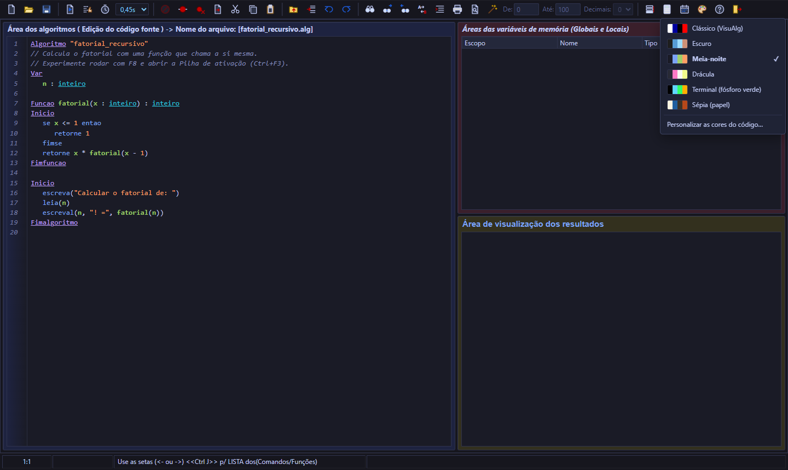
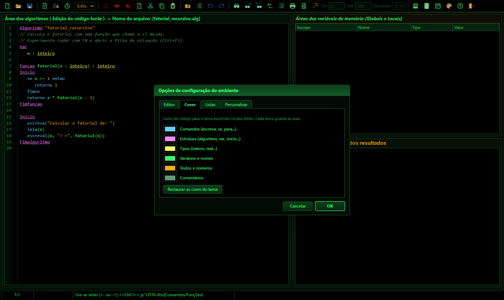
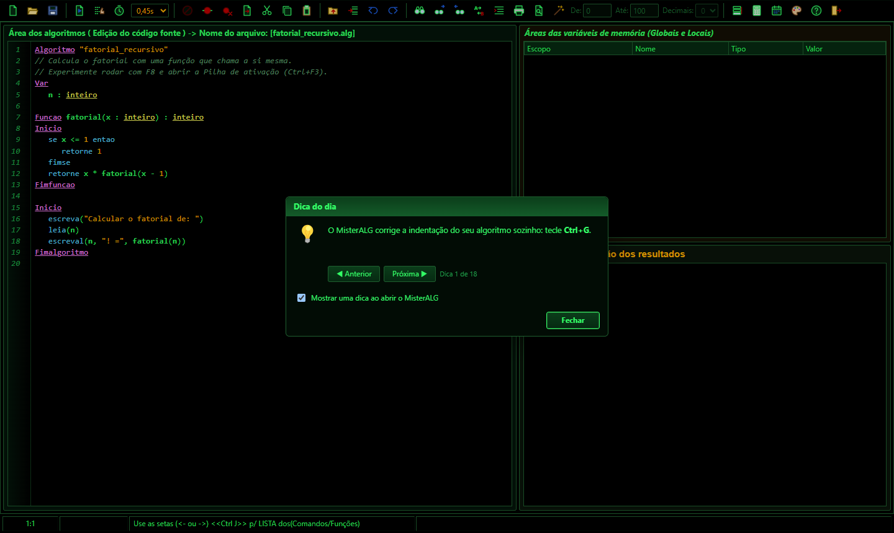

<p align="center">
  
</p>

<p align="center">
  <a href="https://github.com/victinjr199xs-cyber/MisterALG/releases/latest"></a>
  <a href="https://github.com/victinjr199xs-cyber/MisterALG/releases"></a>
  <a href="https://github.com/victinjr199xs-cyber/MisterALG/actions/workflows/pacotes.yml"></a>
  <a href="LICENSE"></a>
  
</p>

<p align="center">
  <a href="https://github.com/victinjr199xs-cyber/MisterALG/releases/latest"></a>
  <a href="https://github.com/victinjr199xs-cyber/MisterALG/releases/latest"></a>
  <a href="https://github.com/victinjr199xs-cyber/MisterALG/releases/latest"></a>
</p>

<p align="center">
  <a href="#-o-que-é">O que é</a> ·
  <a href="#-baixar-e-instalar">Instalar</a> ·
  <a href="#-recursos">Recursos</a> ·
  <a href="#-veja-funcionando">Prints</a> ·
  <a href="#-a-linguagem">Linguagem</a> ·
  <a href="#-créditos">Créditos</a> ·
  <a href="docs/COMO-FUNCIONA.md">Como funciona</a>
</p>

---

## 💡 O que é

O **MisterALG** é um ambiente para aprender lógica de programação escrevendo algoritmos em
**Portugol** — pseudocódigo em português. Ele foi **inspirado no [VisuAlg](#-créditos)**, a
ferramenta usada há anos em escolas e faculdades do Brasil, e fala a mesma língua: mesma linguagem,
mesmos menus, mesmas teclas e até as mesmas mensagens de erro da versão 3.0.7.

O VisuAlg roda só no Windows. O MisterALG nasceu para que quem tem **Mac** ou **Linux** também possa
estudar com ele — e, claro, também roda no **Windows**.

<table>
<tr>
<td align="center" width="25%">🖥️<br><b>3 sistemas</b><br><sub>Windows, macOS e Linux</sub></td>
<td align="center" width="25%">🔁<br><b>Compatível</b><br><sub>abre e salva os <code>.alg</code> do VisuAlg</sub></td>
<td align="center" width="25%">🔒<br><b>100% offline</b><br><sub>sem conta, sem anúncio, sem coleta de dados</sub></td>
<td align="center" width="25%">🆓<br><b>Grátis e aberto</b><br><sub>licença MIT</sub></td>
</tr>
</table>

## ⬇️ Baixar e instalar

Todos os arquivos estão na página **[Releases](https://github.com/victinjr199xs-cyber/MisterALG/releases/latest)**:

| | Sistema | Arquivo | Como instalar |
|:-:|---|---|---|
|  | **Windows** | `MisterALG-x.y.z-instalador.exe` | Assistente em português (termos, pasta, atalhos) |
|  | **Windows** (sem instalar) | `MisterALG-x.y.z-portatil.exe` | É só abrir — ótimo para pendrive ou PC da escola |
|  | **macOS** (Intel e Apple Silicon) | `MisterALG-x.y.z.dmg` | Arraste para **Aplicativos** |
|  | **Ubuntu, Mint, Debian, Pop!_OS** | `misteralg_x.y.z_amd64.deb` | Duplo clique, ou `sudo apt install ./misteralg_*.deb` |
|  | **Fedora, openSUSE** | `misteralg-x.y.z.x86_64.rpm` | `sudo dnf install ./misteralg-*.rpm` |
|  | **Outras distribuições** | `.AppImage` ou `.tar.gz` | Sem instalar |

> [!TIP]
> **Primeira abertura:** o MisterALG não tem certificado digital pago, então o sistema pode avisar.
> É normal — veja abaixo como liberar.

<details>
<summary><b>🛡️ Liberando o app na primeira abertura</b></summary>

<br>

- **Windows:** "O Windows protegeu o computador" → **Mais informações** → **Executar assim mesmo**.
- **macOS 15 ou mais novo:** tente abrir, depois **Ajustes do Sistema › Privacidade e Segurança** →
  **Abrir Mesmo Assim**. No macOS 14 ou anterior: botão direito no app › **Abrir**.
  Se aparecer "está danificado": `xattr -dr com.apple.quarantine /Applications/MisterALG.app`
- **Ubuntu 23.10 ou mais novo:** use o **`.deb`**. Ele instala um perfil do AppArmor que permite ao
  MisterALG usar a caixa de proteção (sandbox) do Chromium — o app abre com toda a segurança ligada.
  O AppImage não consegue instalar esse perfil; no Ubuntu recente, só use-o com `--no-sandbox` se não
  puder instalar o `.deb`. Algumas distribuições precisam de `libfuse2` para AppImages.
- **Mac:** as teclas F (F8, F9…) podem precisar da tecla **fn**.

</details>

## ✨ Recursos

### 🌍 Oito linguagens, dezoito idiomas
- **Tela inicial**: o app abre só nela; escolha a linguagem e a IDE carrega já pronta para ela.
- **Portugol** com a tela do VisuAlg; **C#, JavaScript, TypeScript, Python, C, C++ e PHP** numa IDE escura de terminal, com mensagens em inglês e modelo `Hello, World!`.
- **F8 (passo a passo)** mostra a pilha de chamadas e os objetos ligados por setas (C#, JS/TS, Python) ou a memória com ponteiros (C).
- **PHP** abre a página gerada ao vivo, ao lado do código.
- **Idioma da interface**: português, inglês, espanhol, francês, alemão, italiano, holandês, polonês, turco, russo, ucraniano, árabe, hindi, indonésio, vietnamita, chinês, japonês e coreano (tela inicial ou **Manutenção → Idioma**).
- **Sair** pergunta se você quer voltar para a tela inicial ou fechar o app.

<table>
<tr>
<td width="50%" valign="top">

### ▶️ Executar e depurar
- **F9** executa; **F8** vai linha a linha com a linha atual **em azul**
- **Pontos de parada** (F5 ou clique na margem)
- **Executar com tempo** (Shift+F9), com o intervalo na barra
- **Pilha de ativação** (Ctrl+F3) — ótima para entender recursão
- **Perfil** (F7): quantas vezes cada linha rodou
- Grade de **variáveis globais e locais**, destacando o que mudou

</td>
<td width="50%" valign="top">

### ⌨️ Escrever código
- Realce de sintaxe nas **cores do VisuAlg**
- **6 temas de cores**, com 4 escuros para programar à noite (botão 🎨 da barra)
- **Cores do código personalizáveis**, guardadas por tema
- **Exportar para Pascal** (Free Pascal)
- **Listas** para o comando `lista` e **dica do dia**
- **Auto-digitação** (Ctrl+Espaço): as 72 abreviaturas do VisuAlg
- **Sugestões** de comandos e funções (Ctrl+J)
- **Corrigir indentação** (Ctrl+G)
- **Localizar e substituir** com palavra inteira, acentos e regex
- Gravar e inserir blocos, imprimir, arquivos recentes

</td>
</tr>
<tr>
<td width="50%" valign="top">

### 🖨️ Console e entrada de dados
- Console no estilo **MS-DOS**, com `leia` digitado ali mesmo
- Cores com `mudacor`, `limpatela`, `pausa`, `timer`, `cronometro`
- **Gerar valores aleatórios** para os `leia` (botão da varinha)
- Comando `arquivo` para ler dados de um arquivo texto

</td>
<td width="50%" valign="top">

### 🧯 Erros que ensinam
- As **mesmas mensagens** do VisuAlg, com a linha marcada
- Uma **explicação** do que costuma causar os erros mais comuns
- **Recuperação** do algoritmo se o app fechar de repente
- **C e C++** com a biblioteca padrão completa (clang embutido, sem instalar nada), com `system("pause")`, `conio.h` e `Sleep()` como no Windows
- **Assistente de IA** opcional (Claude, ChatGPT/Codex, DeepSeek, Gemini, Ollama…): explica o código e o erro, com um **modo dica** que não entrega a resposta
- Nada é enviado para a internet, a não ser que você ative o assistente de IA (com o Ollama, nem ele)

</td>
</tr>
</table>

## 📸 Veja funcionando

<p align="center">
  
  <br><sub><b>Passo a passo (F8)</b> ordenando um vetor: a linha azul anda e as variáveis se atualizam.</sub>
</p>

<table>
<tr>
<td width="50%"><p align="center"><sub><b>Executar (F9)</b> — console com <code>leia</code> e grade de variáveis</sub></p></td>
<td width="50%"><p align="center"><sub><b>Ponto de parada</b> dentro de uma função recursiva</sub></p></td>
</tr>
<tr>
<td width="50%"><p align="center"><sub><b>Pilha de ativação</b> (Ctrl+F3)</sub></p></td>
<td width="50%"><p align="center"><sub><b>Erro explicado</b>, com a linha marcada</sub></p></td>
</tr>
<tr>
<td width="50%"><p align="center"><sub><b>Sugestões</b> de comandos (Ctrl+J)</sub></p></td>
<td width="50%"><p align="center"><sub><b>Perfil</b>: quantas vezes cada linha rodou (F7)</sub></p></td>
</tr>
</table>

### 🎨 Temas

Cansou do fundo claro? Clique no botão da **paleta** 🎨 na barra (ou em **Manutenção → Tema**) e escolha um tema. O MisterALG guarda a escolha. Nos temas escuros, a barra de título e os menus também ficam escuros. Em **Configurações → Cores** você muda a cor de cada tipo de palavra do código, e cada tema guarda as suas.

<p align="center"></p>

<table>
<tr>
<td width="50%"><p align="center"><sub><b>Escuro</b>: cinza neutro, como os editores modernos</sub></p></td>
<td width="50%"><p align="center"><sub><b>Meia-noite</b>: azul-marinho profundo</sub></p></td>
</tr>
<tr>
<td width="50%"><p align="center"><sub><b>Drácula</b>: roxo, com a paleta Dracula</sub></p></td>
<td width="50%"><p align="center"><sub><b>Terminal</b>: fósforo verde no preto, com destaques em âmbar</sub></p></td>
</tr>
<tr>
<td width="50%"><p align="center"><sub><b>Sépia</b>: claro, mas cor de papel em vez de branco</sub></p></td>
<td width="50%"><p align="center"><sub><b>Clássico</b>: as cores originais do VisuAlg (padrão)</sub></p></td>
</tr>
</table>

### 🧰 Mais ferramentas

<table>
<tr>
<td width="50%"><p align="center"><sub><b>Exportar para → Pascal</b>: o algoritmo vira um programa Free Pascal</sub></p></td>
<td width="50%"><p align="center"><sub><b>Cores</b>: escolha a cor de cada tipo de palavra</sub></p></td>
</tr>
<tr>
<td width="50%"><p align="center"><sub><b>Listas</b>: com <code>aleatorio on</code>, <code>lista MESES</code> sorteia um mês no <code>leia</code></sub></p></td>
<td width="50%"><p align="center"><sub><b>Dica do dia</b> ao abrir (e no menu Ajuda)</sub></p></td>
</tr>
</table>

## 📝 A linguagem

```
Algoritmo "media"
Var
   nota1, nota2, media : real
Inicio
   escreva("Primeira nota: ")
   leia(nota1)
   escreva("Segunda nota: ")
   leia(nota2)
   media <- (nota1 + nota2) / 2
   se media >= 7 entao
      escreval("Aprovado com ", media:4:1)
   senao
      escreval("Reprovado")
   fimse
Fimalgoritmo
```

Tudo o que o VisuAlg 3.0.7 tem:

| Tipos e dados | Controle | Subprogramas | Extras |
|---|---|---|---|
| `inteiro`, `real`, `caractere`, `logico` | `se … senao … fimse` | `procedimento` e `funcao` | 28 funções (`raizq`, `copia`, `randi`…) |
| vetores e matrizes `vetor[1..3,1..3]` | `escolha / caso` (com faixas) | parâmetros por valor e `var` | `aleatorio`, `timer`, `pausa`, `debug` |
| `const` e registros (`tipo … registro`) | `para`, `enquanto`, `repita` | recursão | `leia` / `escreva` com `x:8:2` |

Palavras com acento (`então`, `faça`, `até`) e `:=` também valem. A pasta **[`exemplos/`](exemplos/)**
tem programas prontos para abrir e experimentar.

## ⌨️ Atalhos

| Tecla | Ação | Tecla | Ação |
|---|---|---|---|
| <kbd>F9</kbd> | Executar / continuar | <kbd>Ctrl</kbd>+<kbd>L</kbd> · <kbd>⌘</kbd>+<kbd>F</kbd> | Localizar |
| <kbd>F8</kbd> | Passo a passo | <kbd>F3</kbd> / <kbd>F4</kbd> | Próximo / anterior |
| <kbd>Shift</kbd>+<kbd>F9</kbd> | Executar com tempo | <kbd>Ctrl</kbd>+<kbd>U</kbd> · <kbd>⌥</kbd><kbd>⌘</kbd>+<kbd>F</kbd> | Substituir |
| <kbd>Ctrl</kbd>+<kbd>F2</kbd> | Parar | <kbd>Ctrl</kbd>+<kbd>G</kbd> | Corrigir indentação |
| <kbd>F5</kbd> / <kbd>Ctrl</kbd>+<kbd>F5</kbd> | Ponto de parada / limpar | <kbd>Ctrl</kbd>+<kbd>J</kbd> | Sugestões |
| <kbd>F7</kbd> | Perfil | <kbd>Ctrl</kbd>+<kbd>Espaço</kbd> | Auto-digitação |
| <kbd>Ctrl</kbd>+<kbd>F3</kbd> | Pilha de ativação | <kbd>Esc</kbd> | Encerra o `leia` / fecha o console |

No Windows e no Linux valem os atalhos originais do VisuAlg (<kbd>Ctrl</kbd>+<kbd>A</kbd> abre,
<kbd>Ctrl</kbd>+<kbd>T</kbd> seleciona tudo, <kbd>Ctrl</kbd>+<kbd>F</kbd> sai); no Mac, os do sistema.

## 🔄 Do VisuAlg para o MisterALG

| | VisuAlg 3.0.7 | MisterALG |
|---|:-:|:-:|
| Windows | ✅ | ✅ |
| macOS | — | ✅ |
| Linux | — | ✅ |
| Mesma linguagem e mensagens de erro | ✅ | ✅ |
| Abre e salva os mesmos `.alg` (Windows-1252) | ✅ | ✅ |
| Mesmos menus, atalhos e painéis | ✅ | ✅ |

## 🙏 Créditos

> [!IMPORTANT]
> O MisterALG só existe porque o **VisuAlg** existiu primeiro. Todo o crédito pela ideia, pela
> linguagem e pela forma de ensinar algoritmos visualmente é dos seus criadores.

- **Prof. Cláudio Morgado de Souza** — criador do VisuAlg, que ele desenvolveu até a versão 2.5 e
  que se tornou uma das ferramentas mais usadas no ensino de lógica de programação no Brasil.
- **Prof. Antonio Carlos Nicolodi** — recebeu os fontes do Prof. Cláudio e deu continuidade ao
  projeto com o **VisuAlg 3.0**, modernizando a interface e o console e acrescentando muitos dos
  recursos usados como referência aqui. Nas palavras dele, na tela "Sobre" do VisuAlg 3.0:
  *"Desenvolvido originalmente até a versão 2.5 pelo professor Cláudio Morgado de Souza, que […] me
  passou os fontes, pra mim dar continuidade ao seu projeto para os usuários (professores e alunos)"*.

O MisterALG é uma **recriação independente**, feita do zero a partir do estudo do comportamento,
dos manuais e da interface do VisuAlg 3.0.7. Ele **não contém código do VisuAlg**, não é afiliado
nem endossado pelos seus autores, e o nome "VisuAlg" é citado apenas para indicar inspiração e
compatibilidade. Se você usa Windows, conheça e prestigie o VisuAlg original.

Feito com software livre: [Electron](https://www.electronjs.org/), [CodeMirror](https://codemirror.net/),
[electron-vite](https://electron-vite.org/) e [electron-builder](https://www.electron.build/).
O C e o C++ rodam com o [Clang/LLVM](https://llvm.org/) compilado para WebAssembly pelo projeto
[YoWASP](https://yowasp.org/) (licenças Apache 2.0 com exceção LLVM e ISC).

## 🛠️ Para desenvolvedores

```bash
npm install
npm test          # interpretador (20) + busca (34) + exemplos (7)
npm run dev       # abre a IDE com recarga automática
npm run build     # compila para app/out/
npm run dist:win  # gera os instaladores (também dist:mac e dist:linux)
```

- 📖 **[Como o MisterALG funciona por dentro](docs/COMO-FUNCIONA.md)** — do texto à linha azul, com diagramas.
- 🧪 Os 73 testes de compatibilidade usam os exemplos que vêm com o VisuAlg (que não podemos
  redistribuir). Se você tem o VisuAlg 3.0.7: `MISTERALG_VISUALG_DIR="caminho/do/visualg3.0.7" npm test`.
- 🤖 Cada push gera os pacotes dos três sistemas no GitHub Actions; no Linux, a IDE empacotada é
  aberta e testada de verdade, com a segurança do Ubuntu ligada.
- 🤝 Quer ajudar? Veja o **[CONTRIBUTING.md](CONTRIBUTING.md)** — relatos de diferenças em relação
  ao VisuAlg são especialmente bem-vindos.

---

<p align="center">
  <br>
  <sub>Feito com ❤️ para quem está aprendendo a programar · <a href="LICENSE">Licença MIT</a></sub>
</p>
