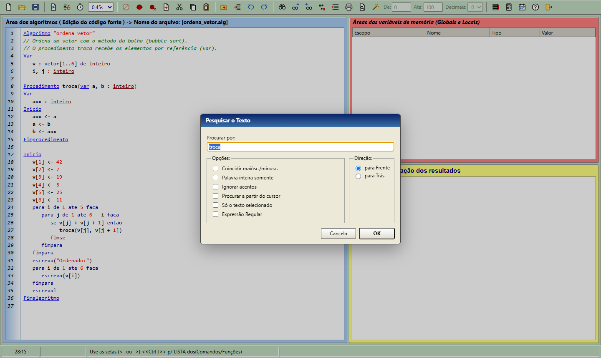

<p align="center">
  
</p>

<h1 align="center">MisterALG</h1>

<p align="center">
  <b>Interpretador, editor e depurador de algoritmos em Portugol</b><br>
  para <b>Windows</b>, <b>macOS</b> e <b>Linux</b> — inspirado no <b>VisuAlg</b>
</p>

<p align="center">
  <a href="https://github.com/victinjr199xs-cyber/MisterALG/releases/latest"><b>⬇️ Baixar a versão mais recente</b></a>
  ·
  <a href="docs/COMO-FUNCIONA.md">Como funciona por dentro</a>
  ·
  <a href="#créditos">Créditos</a>
</p>

<p align="center">
  
</p>

---

## O que é

O **MisterALG** é um ambiente para aprender lógica de programação escrevendo algoritmos em
**Portugol** (pseudocódigo em português). Ele foi **inspirado no [VisuAlg](#créditos)**, a ferramenta
usada há anos em escolas e faculdades do Brasil, e segue a mesma linguagem, os mesmos menus, as
mesmas teclas e até as mesmas mensagens de erro da versão 3.0.7.

O VisuAlg roda só no Windows. O MisterALG nasceu para que quem usa **Mac** ou **Linux** também possa
estudar com ele — e roda no Windows também.

- ✅ Os arquivos `.alg` feitos no VisuAlg abrem e rodam no MisterALG — e os salvos no MisterALG
  continuam abrindo no VisuAlg (mesma codificação, Windows-1252).
- ✅ Funciona 100% offline, sem conta, sem propaganda e sem coletar dados.
- ✅ Gratuito e de código aberto (Licença MIT).

## Baixar e instalar

Na página **[Releases](https://github.com/victinjr199xs-cyber/MisterALG/releases/latest)**:

| Sistema | Arquivo | Observação |
|---|---|---|
| **Windows** | `MisterALG-x.y.z-instalador.exe` | Assistente em português: termos de uso, pasta, atalhos e associação dos `.alg` |
| **Windows** | `MisterALG-x.y.z-portatil.exe` | Roda sem instalar (pendrive, PC da escola) |
| **macOS** (Intel e Apple Silicon) | `MisterALG-x.y.z.dmg` | Arraste para Aplicativos |
| **Ubuntu, Mint, Debian, Pop!_OS** | `misteralg_x.y.z_amd64.deb` | `sudo apt install ./misteralg_*.deb` |
| **Fedora, openSUSE** | `misteralg-x.y.z.x86_64.rpm` | `sudo dnf install ./misteralg-*.rpm` |
| **Outras distribuições Linux** | `MisterALG-x.y.z-x86_64.AppImage` / `.tar.gz` | Sem instalar |

<details>
<summary><b>Avisos de segurança na primeira abertura (é normal)</b></summary>

O MisterALG não tem certificado digital pago (Apple/Microsoft), então o sistema avisa na primeira vez:

- **Windows:** "O Windows protegeu o computador" → **Mais informações** → **Executar assim mesmo**.
- **macOS 15 ou mais novo:** tente abrir, depois vá em **Ajustes do Sistema › Privacidade e
  Segurança** e clique em **Abrir Mesmo Assim**. No macOS 14 ou anterior: botão direito no app ›
  **Abrir**. Se aparecer "está danificado": `xattr -dr com.apple.quarantine /Applications/MisterALG.app`.
- **Ubuntu 23.10 ou mais novo:** use o **`.deb`**. Ele instala um perfil do AppArmor que permite ao
  MisterALG usar a caixa de proteção (sandbox) do Chromium — o app abre com toda a segurança ligada.
  O AppImage não consegue instalar esse perfil; no Ubuntu recente, só rode-o com `--no-sandbox` se
  não puder usar o `.deb`. Algumas distribuições precisam de `libfuse2` para AppImages.
- **Teclas F (F8, F9…) no Mac:** podem precisar da tecla **fn**.
</details>

## Como é

### Executar um algoritmo (F9)
O programa roda no **console** (à direita, embaixo); o `leia` espera você digitar ali mesmo, e a
grade mostra o valor de cada variável.


### Passo a passo (F8) e pontos de parada (F5)
A linha em azul é a próxima a executar. As variáveis (globais e locais) se atualizam a cada passo.


### Pilha de ativação (Ctrl+F3)
Mostra as funções e procedimentos em andamento — ótimo para entender recursão.


### Erros explicados
Quando algo dá errado, o MisterALG marca a linha, mostra a mensagem (as mesmas do VisuAlg) e
explica o que costuma causar o problema.


### Ajudas de digitação
**Ctrl+J** lista comandos e funções; **Ctrl+Espaço** expande abreviaturas (`see` → `se … entao …
fimse`, `par` → `para … fimpara`, `!` → um algoritmo novo — são as 72 abreviaturas do VisuAlg);
**Ctrl+G** corrige a indentação.


### Localizar e substituir, perfil de execução



## A linguagem

```
Algoritmo "media"
Var
   nota1, nota2, media : real
Inicio
   escreva("Primeira nota: ")
   leia(nota1)
   escreva("Segunda nota: ")
   leia(nota2)
   media <- (nota1 + nota2) / 2
   se media >= 7 entao
      escreval("Aprovado com ", media:4:1)
   senao
      escreval("Reprovado")
   fimse
Fimalgoritmo
```

Tudo o que o VisuAlg 3.0.7 tem: `inteiro`, `real`, `caractere`, `logico`; vetores e matrizes
(`vetor[1..10,1..3] de real`); `const`; registros (`tipo … registro … fimregistro`); `se`,
`escolha/caso` (com faixas `caso 1 ate 5`), `para`, `enquanto`, `repita`, `interrompa`;
procedimentos e funções com parâmetros por valor e por referência (`var`) e recursão; `leia` e
`escreva` com formatação (`x:8:2`); as 28 funções pré-definidas (`raizq`, `copia`, `randi`,
`maiusc`…); e os comandos especiais (`aleatorio`, `timer`, `pausa`, `debug`, `eco`, `cronometro`,
`limpatela`, `mudacor`, `arquivo`). Palavras com acento (`então`, `faça`, `até`) também valem.

A pasta **[`exemplos/`](exemplos/)** tem programas prontos para abrir e experimentar.

## Atalhos principais

| Tecla | Ação | | Tecla | Ação |
|---|---|---|---|---|
| **F9** | Executar / continuar | | **Ctrl+L** (⌘F no Mac) | Localizar |
| **F8** | Passo a passo | | **F3 / F4** | Próximo / anterior |
| **Shift+F9** | Executar com tempo | | **Ctrl+U** (⌥⌘F no Mac) | Substituir |
| **Ctrl+F2** | Parar | | **Ctrl+G** | Corrigir indentação |
| **F5 / Ctrl+F5** | Ponto de parada / limpar todos | | **Ctrl+J** | Lista de comandos |
| **F7** | Perfil | | **Ctrl+Espaço** | Auto-digitação |
| **Ctrl+F3** | Pilha de ativação | | **Esc** | Termina o `leia` / fecha o console |

No Windows e no Linux valem os atalhos originais do VisuAlg (Ctrl+A abre, Ctrl+T seleciona tudo,
Ctrl+F sai); no Mac, os do sistema (⌘O, ⌘A, ⌘Q).

## Créditos

O MisterALG só existe porque o **VisuAlg** existiu primeiro. Todo o crédito pela ideia, pela
linguagem e pela forma de ensinar algoritmos visualmente é dos seus criadores:

- **Prof. Cláudio Morgado de Souza** — criador do VisuAlg, que ele desenvolveu até a versão 2.5 e
  que se tornou uma das ferramentas mais usadas no ensino de lógica de programação no Brasil.
- **Prof. Antonio Carlos Nicolodi** — recebeu os fontes do Prof. Cláudio e deu continuidade ao
  projeto com o **VisuAlg 3.0**, que modernizou a interface e o console e acrescentou muitos dos
  recursos usados como referência aqui (como ele mesmo registra na tela "Sobre" do VisuAlg 3.0:
  *"Desenvolvido originalmente até a versão 2.5 pelo professor Cláudio Morgado de Souza, que […] me
  passou os fontes, pra mim dar continuidade ao seu projeto para os usuários (professores e alunos)"*).

O MisterALG é uma **recriação independente**, feita do zero a partir do estudo do comportamento,
dos manuais e da interface do VisuAlg 3.0.7. Ele **não contém código do VisuAlg**, não é afiliado
nem endossado pelos seus autores, e o nome "VisuAlg" é citado apenas para indicar compatibilidade
e inspiração. Se você é professor ou aluno e usa Windows, conheça e prestigie o VisuAlg original.

Também usamos software livre de terceiros: [Electron](https://www.electronjs.org/),
[CodeMirror](https://codemirror.net/), [electron-vite](https://electron-vite.org/) e
[electron-builder](https://www.electron.build/).

## Para desenvolvedores

```bash
npm install
npm test          # 20 testes do interpretador + 34 da busca + 7 dos exemplos
npm run dev       # abre a IDE com recarga automática
npm run build     # compila para app/out/
npm run dist:win  # gera instaladores (também dist:mac e dist:linux)
```

- Como o interpretador e a IDE funcionam: **[docs/COMO-FUNCIONA.md](docs/COMO-FUNCIONA.md)**.
- Os 73 testes de compatibilidade com o VisuAlg usam os exemplos que vêm com ele (que não podemos
  redistribuir). Se você tem o VisuAlg 3.0.7: `MISTERALG_VISUALG_DIR="caminho/do/visualg3.0.7" npm test`.
- Cada push gera os pacotes dos três sistemas no GitHub Actions; no Linux a IDE empacotada é aberta
  e testada de verdade, com a segurança do Ubuntu ligada.
- Quer ajudar? Veja o [CONTRIBUTING.md](CONTRIBUTING.md).

## Licença

[MIT](LICENSE) — use, estude, modifique e compartilhe à vontade, mantendo os créditos.
