<p align="center">
  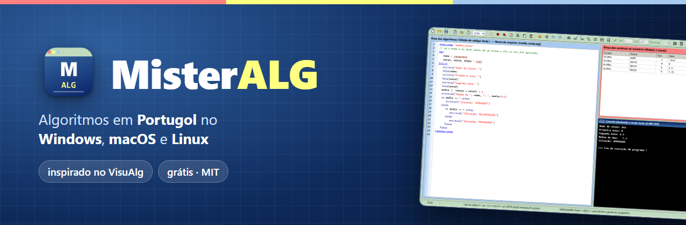
</p>

<p align="center">
  <b>Aprenda a programar vendo o código rodar.</b><br>
  <sub>Portugol como no VisuAlg, e mais oito linguagens (incluindo SQL com PostgreSQL) com passo a passo, memória e objetos na tela.</sub>
</p>

<p align="center">
  <a href="https://github.com/victinjr199xs-cyber/MisterALG/releases/latest"></a>
  <a href="https://github.com/victinjr199xs-cyber/MisterALG/releases"></a>
  <a href="https://github.com/victinjr199xs-cyber/MisterALG/actions/workflows/pacotes.yml"></a>
  
  
  <a href="LICENSE"></a>
</p>

<p align="center">
  <a href="https://github.com/victinjr199xs-cyber/MisterALG/releases/latest"></a>
  <a href="https://github.com/victinjr199xs-cyber/MisterALG/releases/latest"></a>
  <a href="https://github.com/victinjr199xs-cyber/MisterALG/releases/latest"></a>
</p>

<p align="center">
  <a href="#-escolha-a-linguagem">Linguagens</a> ·
  <a href="#️-baixar-e-instalar">Instalar</a> ·
  <a href="#-veja-funcionando">Prints</a> ·
  <a href="#-para-quem-é">Para quem é</a> ·
  <a href="#-portugol">Portugol</a> ·
  <a href="#-idiomas">Idiomas</a> ·
  <a href="CHANGELOG.md">Novidades</a> ·
  <a href="#-créditos">Créditos</a>
</p>

---

## 🧭 Em 30 segundos

O **MisterALG** é um ambiente gratuito para aprender lógica de programação. Você escolhe a linguagem
na tela inicial, escreve o programa e aperta **F8**: ele roda **uma linha por vez** e mostra o que
está acontecendo por dentro — as variáveis, a pilha de chamadas, os objetos ligados por setas, a
memória e os ponteiros do C.

Começou como o **[VisuAlg](#-créditos) para Mac e Linux** (mesma linguagem, menus, teclas e mensagens
de erro da versão 3.0.7) e hoje vai além do Portugol.

<table>
<tr>
<td align="center" width="25%">🖥️<br><b>3 sistemas</b><br><sub>Windows, macOS e Linux</sub></td>
<td align="center" width="25%">🔁<br><b>Compatível com o VisuAlg</b><br><sub>abre e salva os mesmos <code>.alg</code></sub></td>
<td align="center" width="25%">🔒<br><b>100% offline</b><br><sub>sem conta, sem anúncio, sem coleta de dados</sub></td>
<td align="center" width="25%">🆓<br><b>Grátis e aberto</b><br><sub>licença MIT</sub></td>
</tr>
</table>

## 🧩 Escolha a linguagem

Tudo roda **dentro do app**, sem instalar compilador nem interpretador.

<table>
<tr>
<td align="center" width="25%"><br><b>Portugol</b><br><sub>Variáveis, pilha de ativação e perfil, como no VisuAlg</sub></td>
<td align="center" width="25%"><br><b>C#</b><br><sub>Pilha de chamadas, objetos e referências com setas</sub></td>
<td align="center" width="25%"><br><b>JavaScript</b><br><sub>Pilha de chamadas e o laço de eventos (Promises e timers)</sub></td>
<td align="center" width="25%"><br><b>TypeScript</b><br><sub>O tipo de cada valor durante a execução</sub></td>
</tr>
<tr>
<td align="center"><br><b>Python</b><br><sub>Objetos e referências ligados por setas, com <code>input()</code></sub></td>
<td align="center">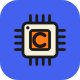<br><b>C</b><br><sub>Memória: pilha, heap e ponteiros desenhados</sub></td>
<td align="center">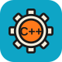<br><b>C++</b><br><sub>Biblioteca padrão completa (clang embutido)</sub></td>
<td align="center"><br><b>PHP</b><br><sub>A página gerada aparece ao vivo, ao lado do código</sub></td>
</tr>
<tr>
<td align="center"><br><b>SQL</b><br><sub>PostgreSQL de verdade: as tabelas mudando a cada comando</sub></td>
<td></td><td></td><td></td>
</tr>
</table>

| | Portugol | C# | JavaScript / TypeScript | Python | C | C++ | PHP | SQL |
|---|:-:|:-:|:-:|:-:|:-:|:-:|:-:|:-:|
| Executar (F9) | ✅ | ✅ | ✅ | ✅ | ✅ | ✅ | ✅ | ✅ |
| Passo a passo (F8) | ✅ | ✅ | ✅ | ✅ | ✅ | ✅¹ | — | um comando por vez |
| Variáveis e pilha na tela | ✅ | ✅ | ✅ | ✅ | ✅ | ✅ | — | tabelas e linhas |
| Objetos e setas | — | ✅ | ✅ | ✅ | ponteiros | ponteiros | página ao vivo | chaves estrangeiras |
| Entrada pelo teclado | `leia` | `Console.ReadLine` | `prompt` | `input()` | `scanf` | `cin` | formulários | — |
| Motor | próprio | próprio (tree-sitter) | Babel + próprio | Pyodide | clang (Wasm) | clang (Wasm) | php-wasm 8.3 | PostgreSQL (PGlite) |

<sub>¹ No passo a passo, C e C++ usam uma biblioteca própria, menor; o F9 usa o compilador completo.</sub>

## ⬇️ Baixar e instalar

Todos os arquivos estão na página **[Releases](https://github.com/victinjr199xs-cyber/MisterALG/releases/latest)**:

| | Sistema | Arquivo | Como instalar |
|:-:|---|---|---|
|  | **Windows** | `MisterALG-x.y.z-instalador.exe` | Assistente em português (termos, pasta, atalhos) |
|  | **Windows** (sem instalar) | `MisterALG-x.y.z-portatil.exe` | É só abrir — ótimo para pendrive ou PC da escola |
|  | **macOS** (Intel e Apple Silicon) | `MisterALG-x.y.z.dmg` | Arraste para **Aplicativos** |
|  | **Ubuntu, Mint, Debian, Pop!_OS** | `misteralg_x.y.z_amd64.deb` | Duplo clique, ou `sudo apt install ./misteralg_*.deb` |
|  | **Fedora, openSUSE** | `misteralg-x.y.z.x86_64.rpm` | `sudo dnf install ./misteralg-*.rpm` |
|  | **Outras distribuições** | `.AppImage` ou `.tar.gz` | Sem instalar |

> [!TIP]
> **Primeira abertura:** o MisterALG não tem certificado digital pago, então o sistema pode avisar.
> É normal — veja abaixo como liberar.

<details>
<summary><b>🛡️ Liberando o app na primeira abertura</b></summary>

<br>

- **Windows:** "O Windows protegeu o computador" → **Mais informações** → **Executar assim mesmo**.
- **macOS 15 ou mais novo:** tente abrir, depois **Ajustes do Sistema › Privacidade e Segurança** →
  **Abrir Mesmo Assim**. No macOS 14 ou anterior: botão direito no app › **Abrir**.
  Se aparecer "está danificado": `xattr -dr com.apple.quarantine /Applications/MisterALG.app`
- **Ubuntu 23.10 ou mais novo:** use o **`.deb`**. Ele instala um perfil do AppArmor que permite ao
  MisterALG usar a caixa de proteção (sandbox) do Chromium. O AppImage não consegue instalar esse
  perfil; no Ubuntu recente, só use-o com `--no-sandbox` se não puder instalar o `.deb`. Algumas
  distribuições precisam de `libfuse2` para AppImages.
- **Mac:** as teclas F (F8, F9…) podem precisar da tecla **fn**.

</details>

## 📸 Veja funcionando

<p align="center">
  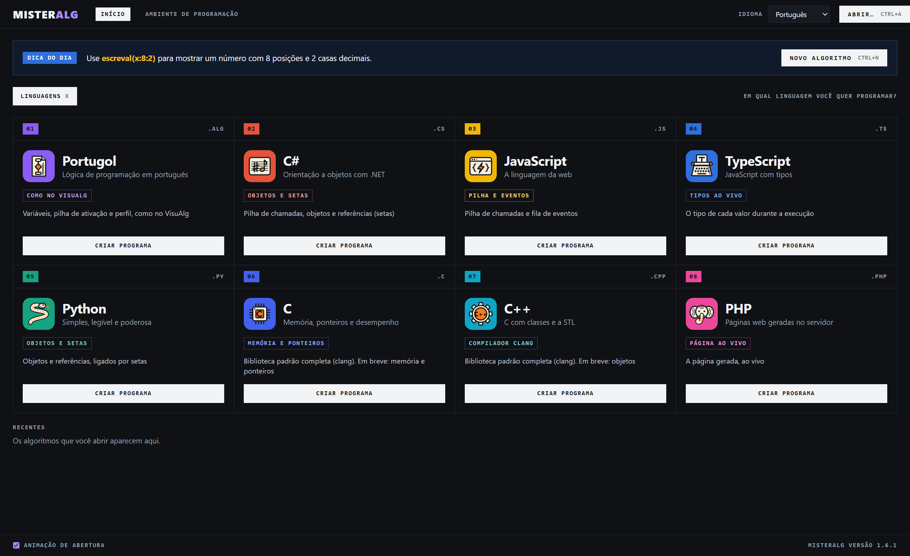
  <br><sub><b>Tela inicial</b>: o app abre aqui. Escolha a linguagem e a IDE carrega pronta para ela.</sub>
</p>

<table>
<tr>
<td width="50%">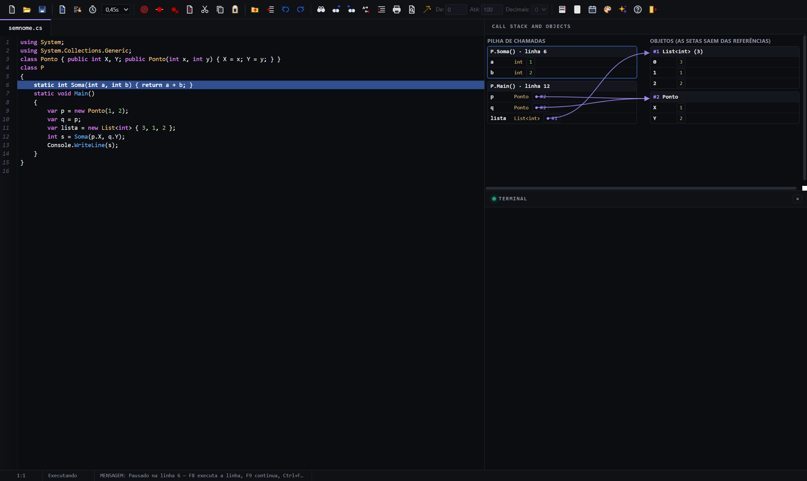<p align="center"><sub><b>C# no passo a passo</b>: cada chamada numa caixa, as referências viram setas</sub></p></td>
<td width="50%">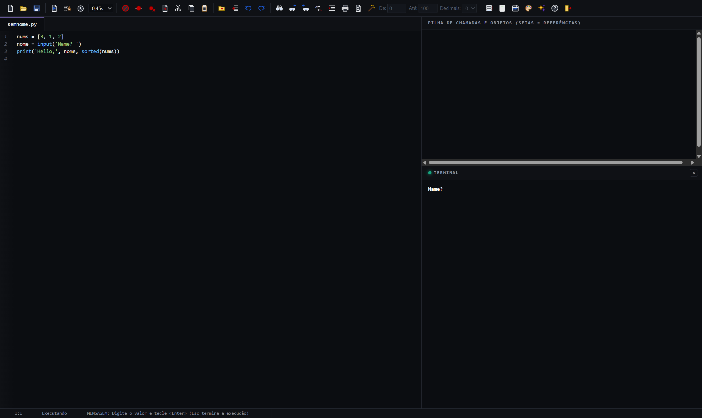<p align="center"><sub><b>Python</b> na IDE escura, com o <code>input()</code> no terminal</sub></p></td>
</tr>
</table>

<p align="center">
  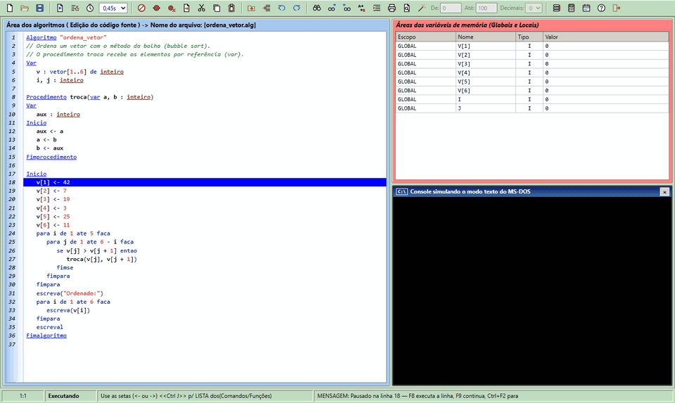
  <br><sub><b>Portugol no passo a passo (F8)</b>: a linha azul anda e as variáveis se atualizam, como no VisuAlg.</sub>
</p>

<p align="center">
  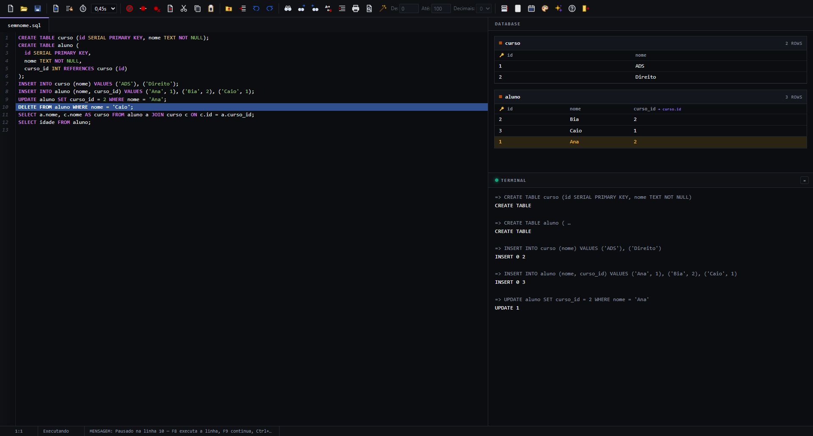
  <br><sub><b>SQL no passo a passo (F8)</b>: cada comando roda no PostgreSQL de verdade; linhas novas em verde, alteradas em amarelo, apagadas riscadas, e o resultado no formato do <code>psql</code>.</sub>
</p>

<details>
<summary><b>Mais telas do Portugol</b></summary>

<table>
<tr>
<td width="50%">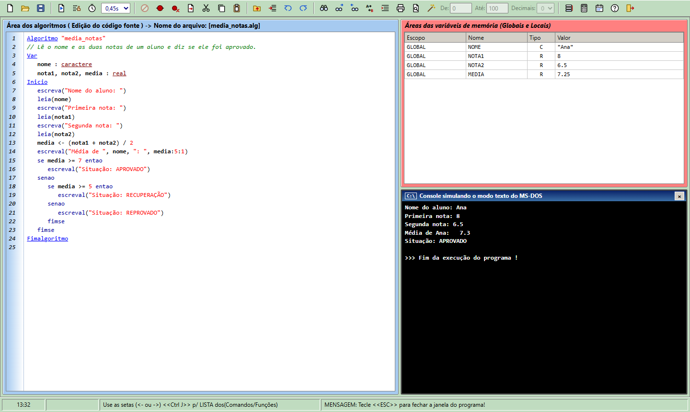<p align="center"><sub><b>Executar (F9)</b> — console com <code>leia</code> e grade de variáveis</sub></p></td>
<td width="50%">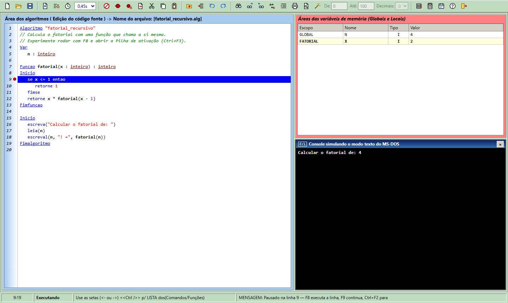<p align="center"><sub><b>Ponto de parada</b> dentro de uma função recursiva</sub></p></td>
</tr>
<tr>
<td width="50%">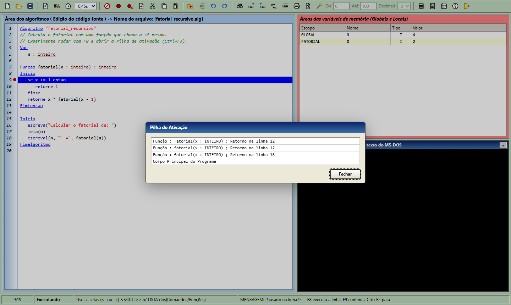<p align="center"><sub><b>Pilha de ativação</b> (Ctrl+F3)</sub></p></td>
<td width="50%">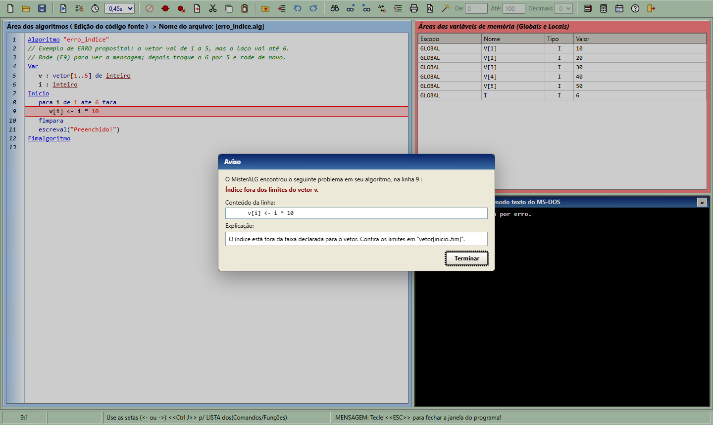<p align="center"><sub><b>Erro explicado</b>, com a linha marcada</sub></p></td>
</tr>
<tr>
<td width="50%">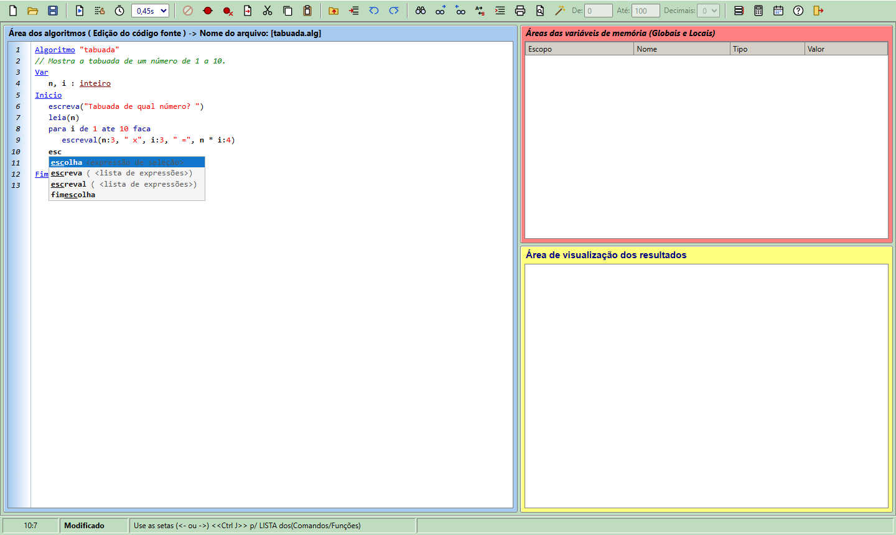<p align="center"><sub><b>Sugestões</b> de comandos (Ctrl+J)</sub></p></td>
<td width="50%">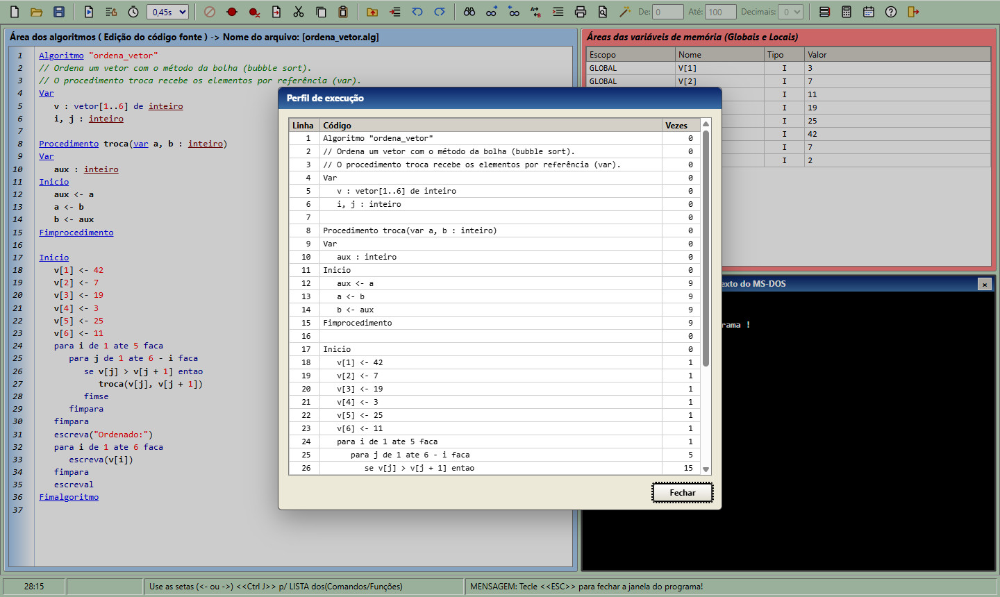<p align="center"><sub><b>Perfil</b>: quantas vezes cada linha rodou (F7)</sub></p></td>
</tr>
<tr>
<td width="50%">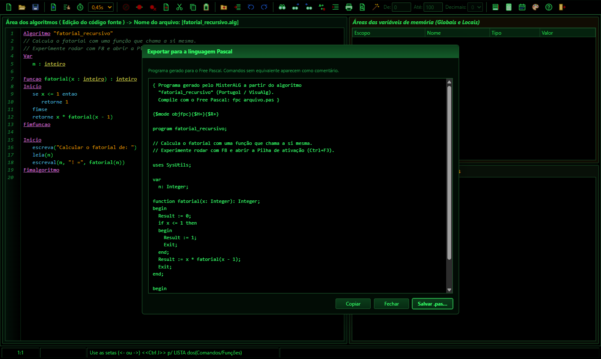<p align="center"><sub><b>Exportar para → Pascal</b></sub></p></td>
<td width="50%">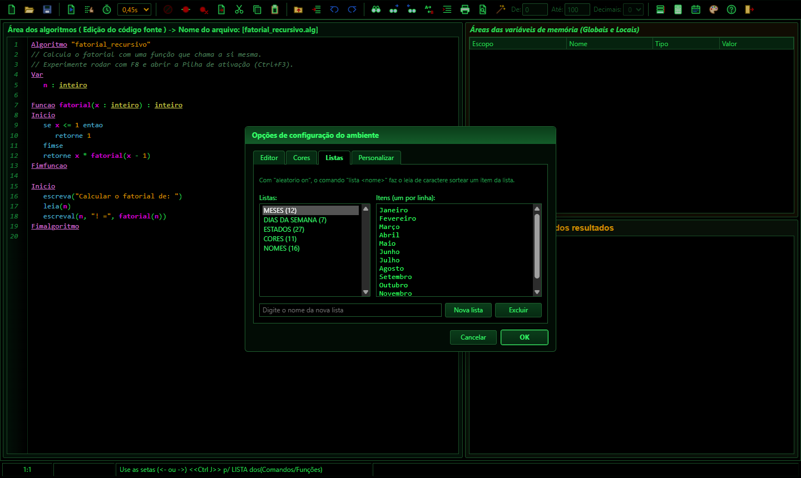<p align="center"><sub><b>Listas</b>: <code>lista MESES</code> sorteia um mês no <code>leia</code></sub></p></td>
</tr>
</table>

</details>

## 🎯 Para quem é

<table>
<tr>
<td width="50%" valign="top">

### 🎒 Para quem está aprendendo
- **Veja o programa pensar**: F8 executa uma linha por vez e destaca o que mudou.
- **Erros que ensinam**: a mensagem, a linha marcada e uma explicação do que costuma causar o erro
  (no Portugol, no C e no C++).
- **Assistente de IA opcional** (Claude, ChatGPT/Codex, DeepSeek, Gemini, Ollama…) com **modo dica**,
  que explica sem entregar a resposta.
- **Pontos de parada** (F5), **perfil** (F7) e **pilha de ativação** (Ctrl+F3) para entender laços e
  recursão.

</td>
<td width="50%" valign="top">

### 🧑‍🏫 Para quem ensina
- **Roda na sala inteira**: Windows, Mac e Linux, inclusive versão **portátil** para pendrive.
- **Compatível com o VisuAlg 3.0.7**: os `.alg` da sua turma abrem e salvam iguais.
- **Cabeçalho automático** (digite `#` + Ctrl+Espaço) com disciplina, professor e data.
- **Gerar valores aleatórios** para o `leia`, **listas** sorteadas e **exportar para Pascal**.
- **Nada sai do computador**, a não ser que o aluno ative o assistente de IA.

</td>
</tr>
<tr>
<td width="50%" valign="top">

### ⌨️ Para escrever código
- Realce de sintaxe em todas as linguagens, **6 temas** (4 escuros) e cores do código por tema.
- **Auto-digitação** (Ctrl+Espaço) com as 72 abreviaturas do VisuAlg e **sugestões** (Ctrl+J).
- **Corrigir indentação** (Ctrl+G), localizar e substituir com regex, blocos, impressão.

</td>
<td width="50%" valign="top">

### 🖨️ Console e terminal
- Portugol: console no estilo **MS-DOS**, com `mudacor`, `limpatela`, `pausa`, `timer` e `arquivo`.
- Outras linguagens: **terminal** escuro, em inglês, como nas ferramentas de verdade
  (`Process finished with exit code 0`).
- PHP: **página ao vivo** que se atualiza enquanto você edita, com a aba "HTML gerado".

</td>
</tr>
</table>

## 📝 Portugol

```
Algoritmo "media"
Var
   nota1, nota2, media : real
Inicio
   escreva("Primeira nota: ")
   leia(nota1)
   escreva("Segunda nota: ")
   leia(nota2)
   media <- (nota1 + nota2) / 2
   se media >= 7 entao
      escreval("Aprovado com ", media:4:1)
   senao
      escreval("Reprovado")
   fimse
Fimalgoritmo
```

Tudo o que o VisuAlg 3.0.7 tem:

| Tipos e dados | Controle | Subprogramas | Extras |
|---|---|---|---|
| `inteiro`, `real`, `caractere`, `logico` | `se … senao … fimse` | `procedimento` e `funcao` | 28 funções (`raizq`, `copia`, `randi`…) |
| vetores e matrizes `vetor[1..3,1..3]` | `escolha / caso` (com faixas) | parâmetros por valor e `var` | `aleatorio`, `timer`, `pausa`, `debug` |
| `const` e registros (`tipo … registro`) | `para`, `enquanto`, `repita` | recursão | `leia` / `escreva` com `x:8:2` |

Palavras com acento (`então`, `faça`, `até`) e `:=` também valem. A pasta **[`exemplos/`](exemplos/)**
tem programas prontos para abrir e experimentar.

<details>
<summary><b>⌨️ Atalhos</b></summary>

| Tecla | Ação | Tecla | Ação |
|---|---|---|---|
| <kbd>F9</kbd> | Executar / continuar | <kbd>Ctrl</kbd>+<kbd>L</kbd> · <kbd>⌘</kbd>+<kbd>F</kbd> | Localizar |
| <kbd>F8</kbd> | Passo a passo | <kbd>F3</kbd> / <kbd>F4</kbd> | Próximo / anterior |
| <kbd>Shift</kbd>+<kbd>F9</kbd> | Executar com tempo | <kbd>Ctrl</kbd>+<kbd>U</kbd> · <kbd>⌥</kbd><kbd>⌘</kbd>+<kbd>F</kbd> | Substituir |
| <kbd>Ctrl</kbd>+<kbd>F2</kbd> | Parar | <kbd>Ctrl</kbd>+<kbd>G</kbd> | Corrigir indentação |
| <kbd>F5</kbd> / <kbd>Ctrl</kbd>+<kbd>F5</kbd> | Ponto de parada / limpar | <kbd>Ctrl</kbd>+<kbd>J</kbd> | Sugestões |
| <kbd>F7</kbd> | Perfil | <kbd>Ctrl</kbd>+<kbd>Espaço</kbd> | Auto-digitação |
| <kbd>Ctrl</kbd>+<kbd>F3</kbd> | Pilha de ativação | <kbd>Esc</kbd> | Encerra o `leia` / fecha o console |

No Windows e no Linux valem os atalhos originais do VisuAlg (<kbd>Ctrl</kbd>+<kbd>A</kbd> abre,
<kbd>Ctrl</kbd>+<kbd>T</kbd> seleciona tudo, <kbd>Ctrl</kbd>+<kbd>F</kbd> sai); no Mac, os do sistema.

</details>

<details>
<summary><b>🎨 Temas</b></summary>

Clique no botão da **paleta** 🎨 na barra (ou em **Manutenção → Tema**). Nos temas escuros, a barra de
título e os menus também ficam escuros. Em **Configurações → Cores** você muda a cor de cada tipo de
palavra do código, e cada tema guarda as suas.

<table>
<tr>
<td width="50%">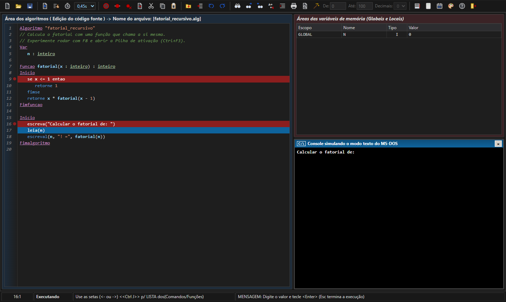<p align="center"><sub><b>Escuro</b></sub></p></td>
<td width="50%">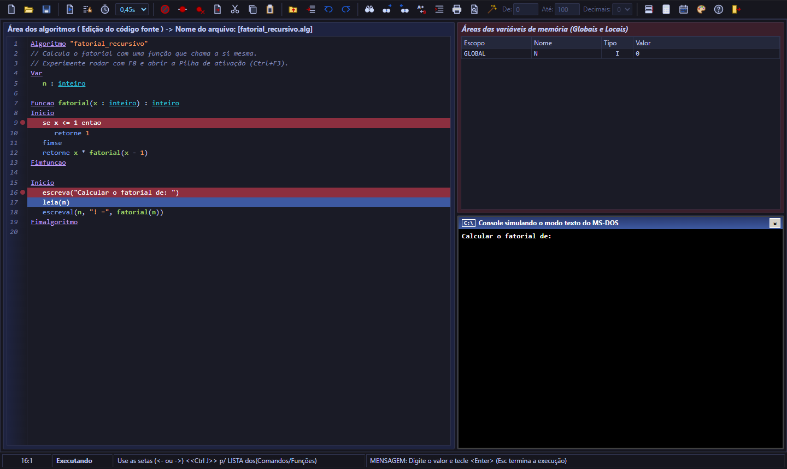<p align="center"><sub><b>Meia-noite</b></sub></p></td>
</tr>
<tr>
<td width="50%">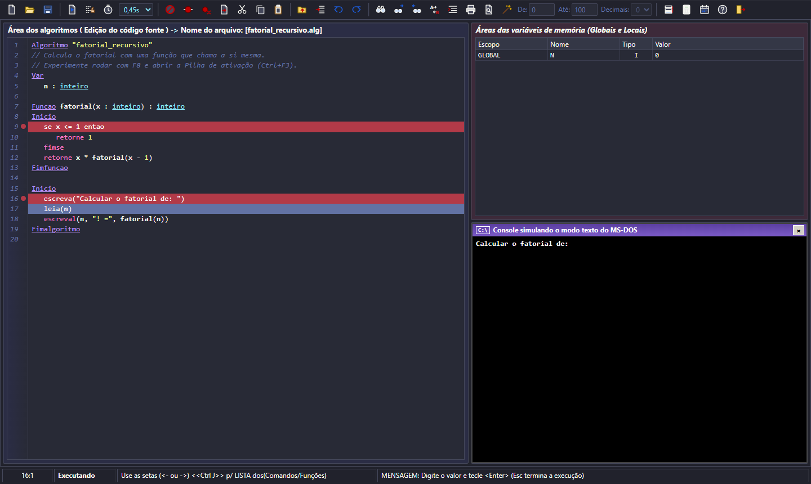<p align="center"><sub><b>Drácula</b></sub></p></td>
<td width="50%">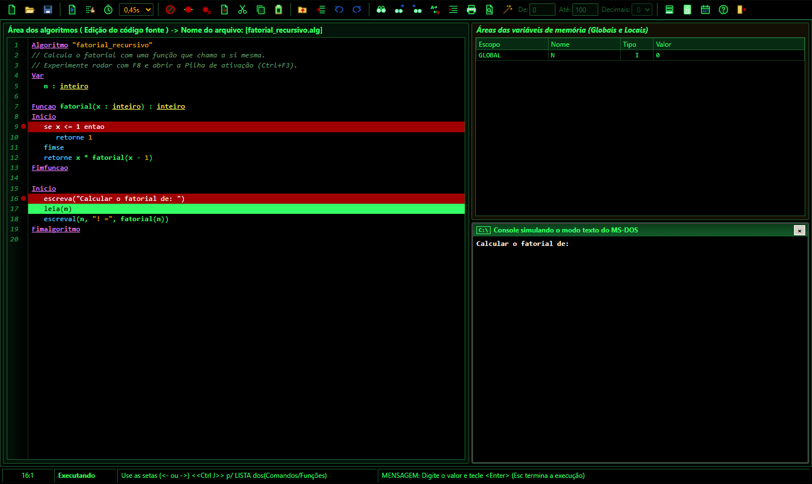<p align="center"><sub><b>Terminal</b></sub></p></td>
</tr>
<tr>
<td width="50%">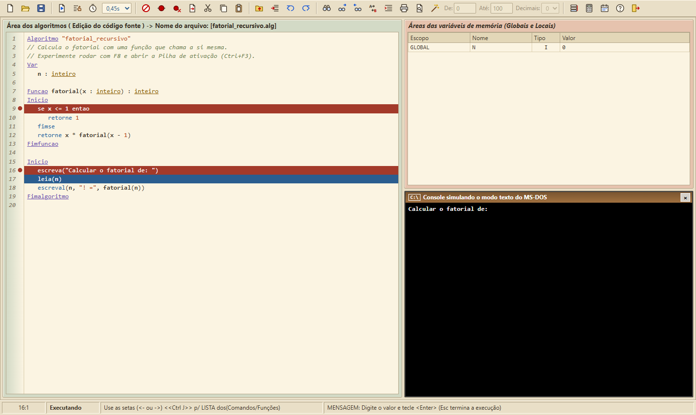<p align="center"><sub><b>Sépia</b></sub></p></td>
<td width="50%">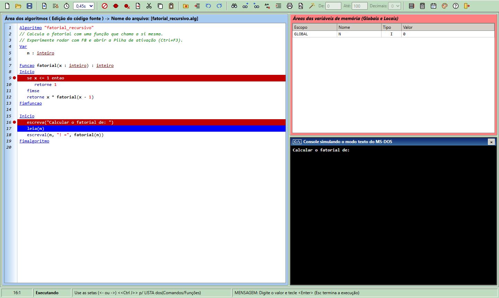<p align="center"><sub><b>Clássico</b> (as cores do VisuAlg)</sub></p></td>
</tr>
</table>

</details>

## 🌐 Idiomas

A interface fala **18 idiomas** — escolha na tela inicial ou em **Manutenção → Idioma**:

> 🇧🇷 Português · 🇺🇸 English · 🇪🇸 Español · 🇫🇷 Français · 🇩🇪 Deutsch · 🇮🇹 Italiano · 🇳🇱 Nederlands ·
> 🇵🇱 Polski · 🇹🇷 Türkçe · 🇷🇺 Русский · 🇺🇦 Українська · 🇸🇦 العربية · 🇮🇳 हिन्दी · 🇮🇩 Bahasa Indonesia ·
> 🇻🇳 Tiếng Việt · 🇨🇳 中文 · 🇯🇵 日本語 · 🇰🇷 한국어

<p align="center">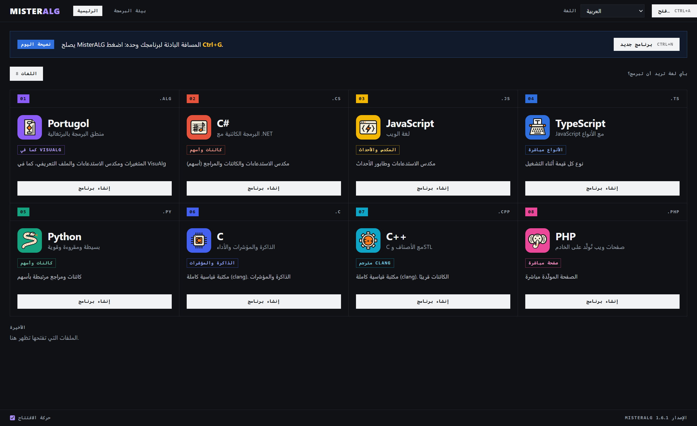<br><sub>A tela inicial em árabe.</sub></p>

São traduzidos o menu, a tela inicial, a barra de ferramentas, as mensagens, as janelas, as dicas e as
janelas do sistema. O **Portugol** continua em português — é a própria linguagem.

## 🔄 Do VisuAlg para o MisterALG

| | VisuAlg 3.0.7 | MisterALG |
|---|:-:|:-:|
| Windows | ✅ | ✅ |
| macOS e Linux | — | ✅ |
| Mesma linguagem, menus, atalhos e mensagens de erro | ✅ | ✅ |
| Abre e salva os mesmos `.alg` (Windows-1252) | ✅ | ✅ |
| Atualiza pelo próprio app | — | ✅ |
| C#, JavaScript, TypeScript, Python, C, C++, PHP e SQL (PostgreSQL) | — | ✅ |
| Objetos, referências e ponteiros desenhados | — | ✅ |
| Interface em 18 idiomas | — | ✅ |

## 🔒 Privacidade

O MisterALG funciona **sem internet**. Não tem conta, anúncio, telemetria nem coleta de dados. Os
programas ficam no seu computador. Ao abrir, ele só pergunta ao GitHub qual é a versão mais nova, para
oferecer a **atualização pelo próprio app** (dá para desligar na tela inicial). A outra exceção é o **assistente de IA**, que vem desligado: quando
você o ativa e faz uma pergunta, o código vai direto para o provedor que você escolheu (com o Ollama,
nem isso — a IA roda no seu computador).

## 🙏 Créditos

> [!IMPORTANT]
> O MisterALG só existe porque o **VisuAlg** existiu primeiro. Todo o crédito pela ideia, pela
> linguagem e pela forma de ensinar algoritmos visualmente é dos seus criadores.

- **Prof. Cláudio Morgado de Souza** — criador do VisuAlg, que ele desenvolveu até a versão 2.5 e
  que se tornou uma das ferramentas mais usadas no ensino de lógica de programação no Brasil.
- **Prof. Antonio Carlos Nicolodi** — recebeu os fontes do Prof. Cláudio e deu continuidade ao
  projeto com o **VisuAlg 3.0**, modernizando a interface e o console e acrescentando muitos dos
  recursos usados como referência aqui. Nas palavras dele, na tela "Sobre" do VisuAlg 3.0:
  *"Desenvolvido originalmente até a versão 2.5 pelo professor Cláudio Morgado de Souza, que […] me
  passou os fontes, pra mim dar continuidade ao seu projeto para os usuários (professores e alunos)"*.

O MisterALG é uma **recriação independente**, feita do zero a partir do estudo do comportamento,
dos manuais e da interface do VisuAlg 3.0.7. Ele **não contém código do VisuAlg**, não é afiliado
nem endossado pelos seus autores, e o nome "VisuAlg" é citado apenas para indicar inspiração e
compatibilidade. Se você usa Windows, conheça e prestigie o VisuAlg original.

Feito com software livre: [Electron](https://www.electronjs.org/), [CodeMirror](https://codemirror.net/),
[electron-vite](https://electron-vite.org/) e [electron-builder](https://www.electron.build/).
As linguagens rodam com [Clang/LLVM](https://llvm.org/) em WebAssembly do projeto
[YoWASP](https://yowasp.org/), [Pyodide](https://pyodide.org/), [php-wasm](https://github.com/WordPress/wordpress-playground),
[tree-sitter](https://tree-sitter.github.io/), [Babel](https://babeljs.io/) e [PGlite](https://pglite.dev/) (PostgreSQL em WebAssembly). Os ícones das linguagens
são desenhos próprios do MisterALG, não os logotipos oficiais.

## 🛠️ Para desenvolvedores

```bash
npm install
npm test          # todos os testes: Portugol, busca, app, idiomas, C, JS, Python, C#, SQL e compatibilidade
npm run dev       # abre a IDE com recarga automática
npm run build     # compila para app/out/
npm run dist:win  # instaladores (também dist:mac e dist:linux), já com Python, PHP, C# e PostgreSQL embutidos
```

| Onde | O quê |
|---|---|
| [`app/`](app/) | O app Electron: processo principal, tela inicial (`inicio.html`) e IDE (`index.html`) |
| [`packages/interpreter`](packages/interpreter) | O interpretador de Portugol |
| [`packages/interpretador-csharp`](packages/interpretador-csharp) | C#: tree-sitter + máquina em geradores, com testes contra o `csc` |
| [`packages/interpretador-js`](packages/interpretador-js) · [`-python`](packages/interpretador-python) · [`-php`](packages/interpretador-php) · [`-c`](packages/interpretador-c) · [`-sql`](packages/interpretador-sql) | As outras linguagens |
| [`app/src/compartilhado/traducoes`](app/src/compartilhado/traducoes) | Os textos da interface (`chaves.js`) e um arquivo por idioma |
| [`scripts/`](scripts/) | Testes de fumaça no app real e preparação dos instaladores |

- 📖 **[Como o MisterALG funciona por dentro](docs/COMO-FUNCIONA.md)** — do texto à linha azul, com diagramas.
- 📰 **[Novidades de cada versão](CHANGELOG.md)**.
- 🧪 Os 73 testes de compatibilidade usam os exemplos que vêm com o VisuAlg (que não podemos
  redistribuir). Se você tem o VisuAlg 3.0.7: `MISTERALG_VISUALG_DIR="caminho/do/visualg3.0.7" npm test`.
- 🌍 Para traduzir um texto novo: acrescente-o em `chaves.js` com o próximo número e em cada idioma;
  o `npm test` avisa o que faltar.
- 🤝 Quer ajudar? Veja o **[CONTRIBUTING.md](CONTRIBUTING.md)** — relatos de diferenças em relação
  ao VisuAlg e revisões das traduções são especialmente bem-vindos.

---

<p align="center">
  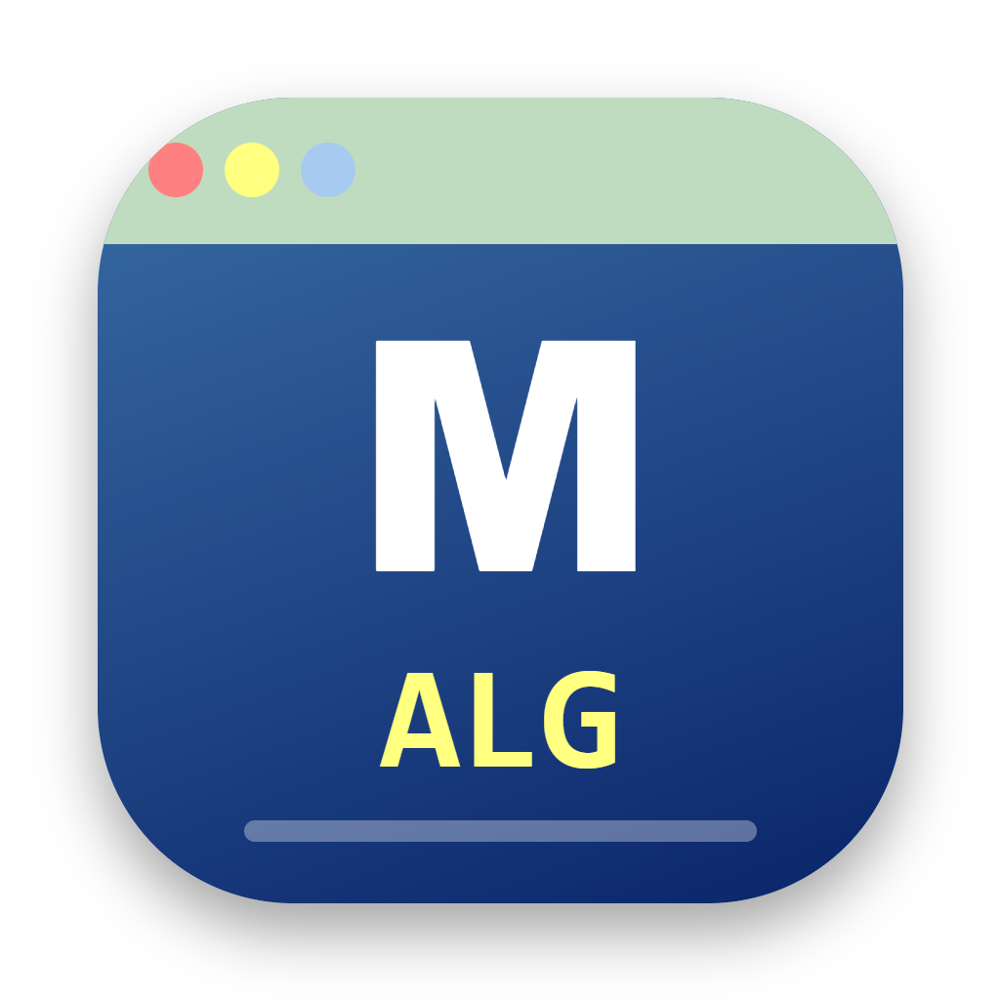<br>
  <sub>Feito com ❤️ para quem está aprendendo a programar · <a href="LICENSE">Licença MIT</a></sub>
</p>
