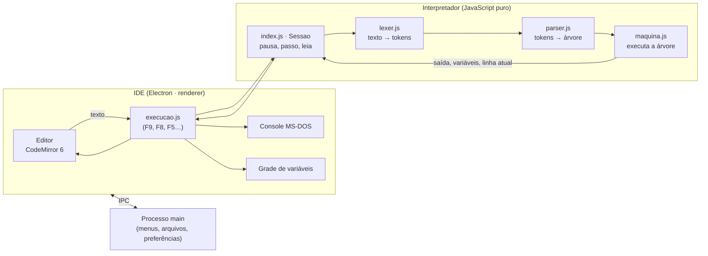
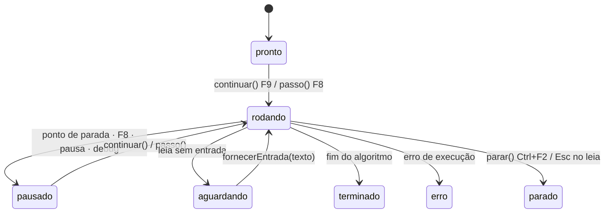

# Como o MisterALG funciona por dentro

Este documento explica, sem pressa, o caminho que um algoritmo em Portugol percorre desde o texto
que você digita até a linha azul andando no editor. Serve para quem quer estudar o código, contribuir
ou só entender como um interpretador funciona.

## Visão geral



O projeto tem três partes (npm workspaces):

| Pasta | O que é |
|---|---|
| `packages/interpreter` | O interpretador de Portugol. JavaScript puro, **sem nenhuma dependência**: roda no Node, no navegador ou no Electron. |
| `packages/editor-busca` | O motor de Localizar/Substituir (texto, palavra inteira, acentos, expressões regulares). |
| `app` | O aplicativo Electron: o processo **main** (janela, menus nativos, arquivos) e o **renderer** (a IDE em si). |

## 1. Do texto aos tokens — `lexer.js`

O Portugol do VisuAlg tem uma regra simples: **um comando por linha**. Por isso o analisador léxico
transforma a quebra de linha em um token próprio (`NL`), e o resto vira números, textos entre aspas,
operadores e palavras.

Cada palavra é guardada duas vezes: como foi escrita (`Então`) e numa forma **normalizada** —
maiúsculas, sem acento, com os sinônimos resolvidos (`ENTAO`). É assim que `então`, `ENTÃO` e
`entao` são a mesma coisa, e que `caracter`, `literal` e `caractere` são o mesmo tipo.

```
escreval("Olá", x)   →   ID(ESCREVAL)  OP(()  STR(Olá)  OP(,)  ID(X)  OP())  NL
```

## 2. Dos tokens à árvore — `parser.js`

O parser é de **descida recursiva**: uma função para cada construção da gramática (`cmdSe`,
`cmdPara`, `expressao`, `termo`…). Ele monta uma **árvore sintática** (AST) e, se encontrar algo
errado, lança o erro com o **texto exato do VisuAlg** e o número da linha (`Esperava encontrar
FIMSE.`, `Variável 'x' não foi encontrada.`…).

A precedência dos operadores segue o VisuAlg: unário (`-x`) > `^` > `* / \ mod` > `+ -` >
relacionais > `nao` > `e` > `ou xou`.

```
se media >= 7 entao ...      →   { s: 'se', cond: { op: '>=', a: media, b: 7 }, entao: [...], senao: [...] }
```

## 3. Executando a árvore — `maquina.js`

A máquina percorre a árvore e executa cada nó. O detalhe que torna possível **passo a passo, pontos
de parada, `leia` e pausa** é que ela é escrita com **generators** do JavaScript (`function*`):

```js
* comando(c) {
  yield { tipo: 'linha', linha: c.linha }   // ← antes de cada linha, a máquina "pausa"
  switch (c.s) { ... }
}
```

Antes de executar cada linha, a máquina entrega (`yield`) um evento e **congela** — inclusive no
meio de uma função recursiva, com toda a pilha de chamadas preservada. Quem decide se ela continua
na hora, espera o próximo F8 ou para num ponto de parada é a `Sessao`.

Outros detalhes:

- **Valores tipados**: cada valor carrega o tipo (`I` inteiro, `R` real, `C` caractere, `L` lógico),
  porque `7/2` é real (3.5) e `7\2` é inteiro (3), e o VisuAlg imprime números com um espaço antes.
- **Escopos**: cada chamada cria um *frame* com as variáveis locais; parâmetros `var` apontam para a
  variável de quem chamou (referência), e os demais são cópias.
- **Vetores N-dimensionais e registros** são guardados como arrays e objetos, com cópia por valor na
  atribuição (`r1 <- r2` copia tudo).
- **Erros de execução** (índice fora do vetor, divisão por zero…) usam as mensagens do VisuAlg.

## 4. A sessão — `index.js`

A `Sessao` é o "controle remoto" da execução:



Para a interface nunca travar — nem num `repita … fimrepita` infinito —, a sessão executa em
**fatias de 20.000 linhas** e devolve o controle ao navegador entre uma fatia e outra. É por isso
que o **Ctrl+F2** sempre consegue parar o programa.

A mesma API é usada pelos testes, sem interface nenhuma:

```js
import { rodar } from '@misteralg/interpreter'
const r = await rodar('algoritmo "a"\ninicio\nescreval(2 + 2)\nfimalgoritmo', { entradas: [] })
r.saida   // " 4\n"
```

## 5. A IDE — `app/src/renderer`

| Arquivo | Papel |
|---|---|
| `editor/editor.js` | CodeMirror 6 com o realce nas cores do VisuAlg, a calha de pontos de parada, a linha azul de execução, `Ctrl+J`, auto-digitação e `Ctrl+G` |
| `execucao.js` | Liga a `Sessao` à tela: console MS-DOS (com o `leia` digitado ali mesmo e as cores do `mudacor`), grade de variáveis destacando o que mudou, avisos de erro |
| `busca.js` | Diálogos "Pesquisar o Texto", "Substituir os textos" e "Confirmar a substituição" |
| `main.js` | Barra de ferramentas, comandos dos menus, abrir/salvar, recuperação após falha |

O processo **main** (`app/src/main`) só cuida do que precisa do sistema: menus nativos (com os
atalhos do VisuAlg no Windows/Linux e os do Mac no macOS), arquivos em **Windows-1252** (para
continuar compatível com o VisuAlg), preferências e lista de arquivos recentes. A comunicação é por
IPC, através de uma ponte mínima (`preload`), e o renderer não tem acesso ao Node.

## 6. Como sabemos que está certo

- **Testes do interpretador** (`packages/interpreter/test`): formatação de números, precedência,
  `escolha` com faixas, recursão, parâmetros por referência, registros, mensagens de erro, passo a
  passo e pontos de parada.
- **Exemplos próprios** (`testes-compat/exemplos.test.mjs`): os programas da pasta `exemplos/`, com a
  saída esperada conferida à mão.
- **Oráculo de compatibilidade** (`testes-compat/p0.test.mjs`): 73 casos que comparam, byte a byte,
  a saída do MisterALG com a esperada para os programas de exemplo que acompanham o VisuAlg 3.0.7
  (é preciso ter o VisuAlg — veja o README).
- **IDE de verdade no CI**: a cada versão, o app empacotado é aberto num Ubuntu sem tela (xvfb), com a
  restrição de segurança do Ubuntu desktop ligada, e um roteiro (`scripts/fumaca-ide.mjs`) executa um
  programa completo pela interface.

## 7. Gerando os pacotes

O GitHub Actions (`.github/workflows/`) roda os testes e gera, a cada versão marcada (`v*`):

- **macOS**: `.dmg` universal (Intel + Apple Silicon), com assinatura ad-hoc;
- **Windows**: instalador NSIS em assistente (termos, pasta, atalhos) e versão portátil;
- **Linux**: AppImage, `.deb` (com perfil do AppArmor para o Ubuntu), `.rpm` e `.tar.gz`.

As imagens desta documentação são geradas pelo próprio app (`scripts/capturas.mjs`, em modo de
captura fora da tela) — se a interface mudar, basta rodar de novo.
